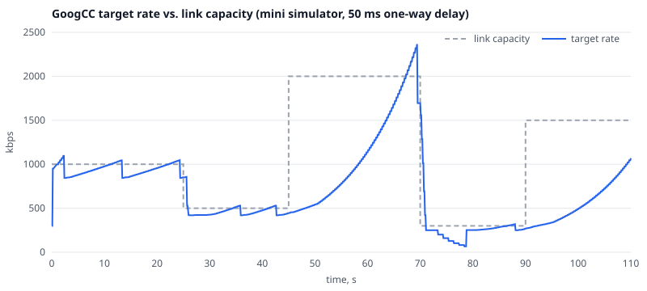

# goog-cc-as

[](https://github.com/irbisadm/goog-cc-as/actions/workflows/ci.yml)

A port of libwebrtc's send-side congestion control (**GoogCC**) from C++ to [AssemblyScript](https://www.assemblyscript.org/), targeting WebAssembly.

The goal is to run the same bandwidth-estimation logic that Chromium uses — outside the browser and outside C++: in an SFU written in Node.js/Deno/Bun, in a browser-side simulator, or in a test harness that replays transport-feedback traces and plots the estimate against the real link capacity.

## Verified bit-exact against upstream C++

The port is checked against upstream C++ GoogCC (libwebrtc M154) by replaying the same controller input through both and comparing every `NetworkControlUpdate` (target rate, loss, RTT, pacer windows, congestion window, probe clusters):

| Scenario | Updates | Port vs C++ |
|---|---|---|
| `capacity-steps` — 1000 → 500 → 2000 → 300 → 1500 kbps | 641 | identical |
| `loss-10pct` — 2 Mbps, 200 ms, 10% loss (loss-based BWE v2) | 383 | identical |
| `no-feedback` — no transport feedback, RTCP loss + REMB, then 15% loss | 189 | identical |
| `route-change` — 200 kbps → 800 kbps route | 116 | identical |
| `remb-cap` — REMB cap to 250 kbps and lifted | 107 | identical |

The inputs are recorded from the scenario simulator. `npm run test:trace` (part of CI) checks the port against the stored C++ outputs in `tests/golden/`; `npm run trace:compare` rebuilds upstream GoogCC from `cpp/` (`tools/cpp-replay`) and compares live. See [tools/replay/README.md](tools/replay/README.md) for the trace format.

RtcEventLog recordings can be replayed too: `npm run trace:from-log -- <log.rtc> <out.trace>` turns a log into a trace the way upstream's `LogBasedNetworkControllerSimulation` (`rtc_tools/rtc_event_log_visualizer`) feeds GoogCC, using the [rtc-event-log](https://github.com/irbisadm/rtc-event-log) parser. Eight logs written by the upstream encoder (`tests/golden/event-log/`) replay identically to C++; they exposed and fixed a wrong default of the ALR detector.

## Speed vs. upstream C++

The same controller input, replayed through the wasm port (Node's V8) and through upstream C++ GoogCC (clang `-O3`). Both sides parse the trace up front and time only building the messages and calling a fresh controller per replay; a checksum over every update confirms they did the same work.

| Trace | Events | C++ ns/event | wasm ns/event | wasm / C++ |
|---|---:|---:|---:|---:|
| `capacity-steps` | 16355 | 337 | 1466 | 4.4× |
| `loss-10pct` | 15075 | 285 | 1278 | 4.5× |
| `no-feedback` | 2178 | 46 | 432 | 9.3× |
| `route-change` | 2021 | 326 | 1574 | 4.8× |
| `remb-cap` | 5353 | 298 | 1416 | 4.8× |

Intel Core i9-13900H, Node 24.22.2 (V8 13.6), clang 23.1, `asc -O3 --noAssert`; median of 7 rounds of ~400k events, repeat runs within ±5 %. The port is about 4.5× slower than native on calls with transport feedback (the outlier is the feedback-less trace, where each C++ call does almost nothing and the fixed wasm overhead per call dominates). In absolute terms that is still small: the 110 s `capacity-steps` call costs about 24 ms of CPU in wasm (5.5 ms in C++), i.e. roughly 0.02 % of one core per call. Reproduce with `npm run bench` (needs `cpp/`, CMake, Ninja and abseil, like `trace:compare`).

## Estimate vs. link capacity



GoogCC running on the test-only scenario simulator (`tests/assembly/scenario`) over a link whose capacity changes in steps, 50 ms one-way delay, 30 fps video. Regenerate with `npm run plot` (writes the SVG and `build/tools/estimate-vs-capacity.csv`). The same scenario's controller input replays bit-exactly through upstream C++ (see above).

## Upstream revision

Ported from libwebrtc **M154** — `branch-heads/8037` @ [`7cb44cfa`](https://webrtc.googlesource.com/src/+/7cb44cfa6c40960ca8d2c1b3f04e2f9e81d35c61) (Chrome 154). GoogCC changes between releases, so compare results against C++ built from this revision. Every ported file starts with a header naming its upstream source and revision, e.g.

```ts
// Port of modules/congestion_controller/goog_cc/alr_detector.{h,cc} @ M154.
```

When a module is re-synced with a newer upstream, update its header and this section.

## Layout

The tree under `assembly/` mirrors upstream, one upstream `.h/.cc` pair per `.ts` file, `snake_case` → `kebab-case`:

| Upstream | Port |
|---|---|
| `api/units/` | `assembly/units/` |
| `api/transport/network_types.h` | `assembly/api/transport/network-types.ts` |
| `api/environment/` | `assembly/api/environment/` (clock only) |
| `system_wrappers/include/clock.h` | `assembly/system-wrappers/clock.ts` |
| `rtc_base/` | `assembly/rtc-base/` |
| `modules/pacing/` | `assembly/modules/pacing/` |
| `modules/congestion_controller/goog_cc/` | `assembly/modules/congestion-controller/goog-cc/` |
| `modules/remote_bitrate_estimator/` | `assembly/modules/remote-bitrate-estimator/` |

Units (`Timestamp`, `TimeDelta`, `DataRate`, `DataSize`) are plain `i64` values in the upstream scale (µs, bps, bytes) with `I64.MAX_VALUE`/`I64.MIN_VALUE` as ±infinity; the API mirrors upstream: `TimeDelta.Millis(5)`, `TimeDelta.ms(d)`, `DataRate.kbps<f64>(r)`. Arithmetic that may hit infinity goes through `Unit.add`/`Unit.sub`.

## Status: work in progress

The whole GoogCC send-side controller is ported; the public entry point is `GoogCcNetworkControllerFactory` / `GoogCcNetworkController` (the `NetworkControllerInterface` API of libwebrtc). The ScreamV2 controller is not ported.

| Component | Upstream | State |
|---|---|---|
| Units (`Timestamp`, `TimeDelta`, `DataSize`, `DataRate`) | `api/units` | ported, tested |
| Network types, `EcnMarking` | `api/transport` | ported, tested |
| `Clock`, `SimulatedClock`, `Environment` | `system_wrappers`, `api/environment` | ported (clock only) |
| `IntervalBudget` | `modules/pacing/interval_budget` | ported, tested |
| `AlrDetector` | `goog_cc/alr_detector` | ported, tested |
| `BitrateEstimator`, `AcknowledgedBitrateEstimator` | `goog_cc` | ported, tested |
| `RobustThroughputEstimator` | `goog_cc/robust_throughput_estimator` | ported, tested |
| `LinkCapacityEstimator` | `goog_cc/link_capacity_estimator` | ported, tested |
| `RttBasedBackoff` | `goog_cc/send_side_bandwidth_estimation` | ported, tested |
| `BandwidthUsage`, `NetworkStatePredictor`, `bwe_defines` | `api/transport`, `api`, `remote_bitrate_estimator/include` | ported |
| `InterArrivalDelta` | `goog_cc/inter_arrival_delta` | ported, tested |
| `TrendlineEstimator` | `goog_cc/trendline_estimator` | ported, tested |
| `AimdRateControl` | `remote_bitrate_estimator/aimd_rate_control` | ported, tested |
| `ProbeBitrateEstimator` | `goog_cc/probe_bitrate_estimator` | ported, tested |
| `SendSideBandwidthEstimation` | `goog_cc/send_side_bandwidth_estimation` | ported, tested |
| `LossBasedBweV2` | `goog_cc/loss_based_bwe_v2` | ported, tested |
| `DelayBasedBwe` | `goog_cc/delay_based_bwe` | ported, tested |
| `ProbeController` | `goog_cc/probe_controller` | ported, tested |
| `CongestionWindowPushbackController`, `RateControlSettings` (congestion window part) | `goog_cc`, `rtc_base/experiments` | ported, tested |
| `NetworkControllerInterface`, `GoogCcNetworkController`, `GoogCcNetworkControllerFactory` | `api/transport`, `goog_cc` | ported, tested (direct tests + scenario tests on the mini simulator) |

"Tested" means the upstream `*_unittest.cc` cases were ported to `tests/assembly/` and pass (where upstream has no unittest, behaviour checks were written instead).

Upstream runs most `GoogCcScenario.*` tests on its `test/scenario` network emulator. Those run here on a small test-only simulator (`tests/assembly/scenario/`) with upstream's expectations and tolerances: a `SimulatedNetwork`-like node (capacity link, pause, loss, delay, queue limit), a sender with a fake 30 fps encoder, a pacer (budget, probes, padding), a `TransportFeedbackAdapter`-like feedback path, TWCC feedback every 50 ms, RTCP SR/RR (+ NACK-triggered reports), receive-side REMB when transport feedback is off, and upstream's `FakeTcpCrossTraffic`. It is a model, not a bit-exact replica of upstream's emulation.

## Field trials

Upstream reads many parameters from field trials (`WebRTC-Bwe-*` and others). Field-trial string parsing is **not** ported: each component takes a config object instead, and its defaults are the upstream defaults — i.e. the behaviour of libwebrtc with no field trials set. Chrome may enable some of these trials through Finch, so a given Chrome build can behave differently. To override a value, construct the config and pass it in:

```ts
const config = new AlrDetectorConfig();
config.bandwidthUsageRatio = 0.9; // WebRTC-AlrDetectorParameters/bw_usage:90%/
const detector = new AlrDetector(createEnvironment(), config);
```

| Field trial | Config | Defaults |
|---|---|---|
| `WebRTC-AlrDetectorParameters` | `AlrDetectorConfig` | `bw_usage` 0.80, `start` 0.40, `stop` -0.60 (`AlrDetectorConfig.defaults()`: upstream's struct defaults 0.65/0.80/0.50 are always overridden by the default-on screenshare experiment below) |
| `WebRTC-ProbingScreenshareBwe`, `WebRTC-StrictPacingAndProbing` | `AlrDetectorConfig.fromExperimentSettings(AlrExperimentSettings)` | screenshare probing on with `1.0,2875,80,40,-60,3` (`AlrExperimentSettings.defaultProbingScreenshareBwe()`), strict pacing off |
| `WebRTC-BweThroughputWindowConfig` | `BitrateEstimatorConfig` | `initial_window_ms` 500, `window_ms` 150 (both limited to 150..1000), `scale` 10, `scale_alr` = `scale`, `scale_small` = `scale`, `small_thresh` 0, `symmetry_cap` 0, `floor` 0 |
| `WebRTC-Bwe-RobustThroughputEstimatorSettings` | `RobustThroughputEstimatorSettings` (call `validate()`) | `enabled` true, `window_packets` 20, `max_window_packets` 500, `window_duration` 1 s, `max_window_duration` 5 s, `required_packets` 10, `unacked_weight` 1.0 |
| `WebRTC-Bwe-TrendlineEstimatorSettings`, `WebRTC-BweWindowSizeInPackets` | `TrendlineEstimatorSettings` (validated in the constructor) | `sort` false, `cap` false, `beginning_packets` 7, `end_packets` 7, `cap_uncertainty` 0.0, `window_size` 20 (10..200) |
| `WebRTC-BweBackOffFactor`, `WebRTC-DontIncreaseDelayBasedBweInAlr`, `WebRTC-Bwe-EstimateBoundedIncrease` | `AimdRateControlConfig` | `backoffFactor` 0.85 (must be in (0, 1)), `noBitrateIncreaseInAlr` false, `Disabled` false, `c_upper` true |
| `WebRTC-Bwe-SeparateAudioPackets` | `BweSeparateAudioPacketsSettings` (part of `DelayBasedBweConfig`, which also carries the `TrendlineEstimatorSettings` and `AimdRateControlConfig` used inside `DelayBasedBwe`) | `enabled` false, `packet_threshold` 10, `time_threshold` 1 s |
| `WebRTC-Bwe-LossBasedBweV2` | `LossBasedBweV2Config` (an invalid or disabled config disables the estimator) | all ~40 keys with upstream defaults, e.g. `Enabled` true, `CandidateFactors` 1.02\|1.0\|0.95, `ObservationWindowSize` 15, `ObservationDurationLowerBound` 250 ms, `InstantUpperBoundBwBalance` 100 kbps, `PaddingDuration` 2 s, `HoldDurationFactor` 2.0; each field is annotated with its key |
| `WebRTC-BweLossExperiment` | `BweLossExperimentConfig` (part of `SendSideBandwidthEstimationConfig`, which also carries `RttBasedBackoffConfig` and `LossBasedBweV2Config`) | off: low loss 0.02, high loss 0.1, bitrate threshold 0 |
| `WebRTC-Bwe-ReceiverLimitCapsOnly` | `SendSideBandwidthEstimationConfig.disableReceiverLimitCapsOnly` | false |
| `WebRTC-Bwe-ProbingConfiguration` (+ `WebRTC-Bwe-AllocationProbing`, `WebRTC-Bwe-ProbingBehavior`), `WebRTC-BweRapidRecoveryExperiment` | `ProbeControllerConfig` | `p1` 3.0, `p2` 6.0, `step_size` 2, `further_probe_threshold` 0.7, `alr_interval` 5 s, `alr_scale` 2, `network_state_interval` +inf, `alloc_p1` 1, `alloc_p2` 2, `min_probe_packets_sent` 5, `min_probe_duration` 15 ms, `min_probe_delta` 2 ms, `loss_limited_scale` 1.5, …; rapid recovery off |
| `WebRTC-CongestionWindow` | `CongestionWindowConfig` → `RateControlSettings` | `QueueSize` 350 ms, `MinBitrate` 30000 bps, `DropFrame` true, `InitWin` unset (use `CongestionWindowConfig.empty()` for an explicitly set trial) |
| `WebRTC-AddPacingToCongestionWindowPushback` | `CongestionWindowPushbackController` constructor flag | off |
| `WebRTC-Bwe-SafeResetOnRouteChange`, `WebRTC-Bwe-MinAllocAsLowerBound`, `WebRTC-Bwe-IgnoreProbesLowerThanNetworkStateEstimate`, `WebRTC-Bwe-LimitProbesLowerThanThroughputEstimate`, `WebRTC-Bwe-LimitPacingFactorByUpperLinkCapacityEstimate` | `GoogCcFieldTrials` (also aggregates the configs of all components above) | safe reset off; the three "IsDisabled" flags on; pacing factor limit off |
| `WebRTC-Bwe-MaxRttLimit` | `RttBasedBackoffConfig` | `Disabled` false, `limit` 3 s, `fraction` 0.8, `interval` 1 s, `floor` 5 kbps |

Out-of-range values are handled as upstream does: they are rejected or replaced with the default.

## Build and test

```sh
nvm use                         # Node version from .nvmrc
npm ci
npm run asbuild                 # build/debug.wasm and build/release.wasm
npm test                        # compile and run every tests/assembly/**/*.spec.ts
node tests/run.js alr-detector  # only specs whose path contains "alr-detector"
node tests/run.js units Clamp   # ...and only tests whose name contains "Clamp"
npm run plot                    # docs/estimate-vs-capacity.svg from the scenario simulator
npm run test:trace              # port vs stored upstream C++ outputs (tests/golden)
npm run trace:compare           # port vs upstream C++ built from cpp/ (CMake, Ninja, system abseil)
npm run bench                   # speed of the wasm port vs upstream C++ (tools/bench, needs cpp/)
npm run trace:from-log -- log.rtc out.trace   # RtcEventLog -> trace (see tools/replay/README.md)
node tools/replay/trace.mjs compare-file out.trace   # port vs upstream C++ for any trace
npm run test:tools              # TransportFeedbackAdapter port + converter tests
```

AssemblyScript projects can consume the sources directly: `ascMain` points to `assembly/index.ts`.

## License

BSD 3-Clause, same as libwebrtc — see [LICENSE](LICENSE). The original code is © The WebRTC project authors; libwebrtc's [additional patent grant](https://webrtc.googlesource.com/src/+/refs/heads/main/PATENTS) applies to the upstream implementation.
